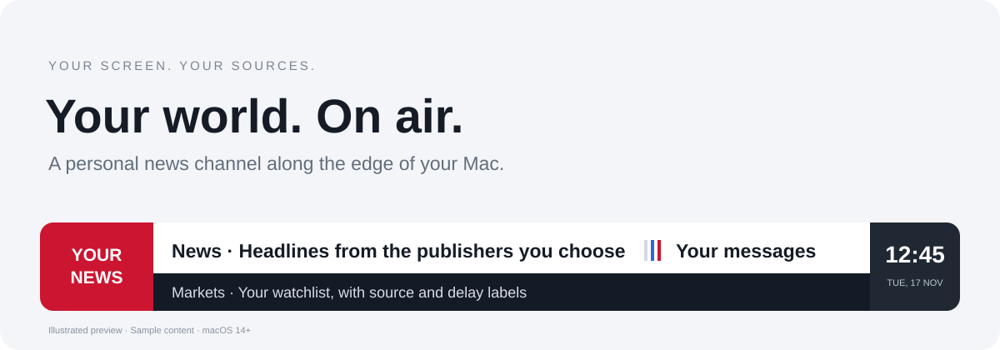

# Stroka

**Your Mac just got its own news channel.**

[Русский](README.ru.md) · [Download the beta](https://github.com/kosbushe/stroka/releases/tag/v0.23.1-beta.1) · [Constitution](CONSTITUTION.md) · [Roadmap](ROADMAP.md)



For the hundred-open-tabs era. Choose the publishers and public Telegram channels you care about, add your watchlist or a message of your own, and let your world scroll along the edge of your screen.

Your name or logo on the left. Time, date and weekday on the right. Your selected information in between. One to four rows. Four looks. Top or bottom.

## Start your own feed

1. Choose sources from the catalog or add an HTTPS RSS/Atom feed. For public Telegram previews, enter **@channel**.
2. Add your name, choose **News**, **Night**, **Minimal** or **Glass**, and preview the result.
3. Press **Start ticker**. Double-click the strip to reopen setup; click or Space to pause.

The catalog contains **550 feed URLs across 11 topics**, including Russian and English sources. These are feed endpoints, not 550 distinct publishers. Source availability changes; the catalog's last full recorded check is from 14 November 2026. Nothing is selected secretly, and no stale news is inserted to fill an empty feed.

## What's in the beta

| Area | Included | Status |
|---|---|---|
| Mac | AppKit/SwiftUI app, top/bottom strip, 1-4 independent rows, four looks, name/logo, clock/date/weekday, 45-180 pt height | Local beta **0.23.1 (30)**, Universal arm64/x86_64 build |
| Content | RSS/Atom, public Telegram previews, own messages, 96 original bilingual offline items, optional short-headline filter | Sources keep their original publication time |
| Freshness | News under 24 hours; explicitly starred highlights under 48 hours | Unknown/future dates excluded; download/edit/translation time does not refresh a story |
| Markets | Coinbase, MOEX and official CBR/ECB rates | Provider and cadence/delay labelled; not uniformly real-time |
| Translation | Apple on-device English-to-Russian translation | macOS 15+ and prepared language models; human quality review remains needed |
| Android TV | Optional receiver mirroring the selected Mac feed | Prototype **0.2.2**, Mac must stay on; pairing/overlay tested on Philips Android TV 11 in receiver 0.2.1 |
| iPhone + autonomous TV | Common SwiftUI editor, QR/TLS pairing and TV-owned source engine | **[Experimental Lab](Labs/Ecosystem/README.md)**. iPhone build/device path and full feature parity are not complete |
| Windows | Contribution/port direction | No Windows app is included |

Lower rows move slightly faster by default. A shared speed control preserves reading position. Named setups live in **Settings → Saved settings**. Text/settings remain local. There is no developer news backend, analytics or advertising SDK.

No arbitrary resizing of other apps, fullscreen signage, countdown timers or social-account OAuth timelines are included. A public Telegram preview is different from a private subscription. HDMI, DRM apps and every TV overlay path are not guaranteed.

## Download or build

The [first GitHub prerelease](https://github.com/kosbushe/stroka/releases/tag/v0.23.1-beta.1) contains the Mac beta, experimental TV receiver and SHA-256 checksums. These are **locally signed prototype builds**, not notarized Developer ID releases or App Store/Google Play apps. Keep macOS protections enabled. Building from source is the supported developer route if your Mac refuses the downloadable beta.

Requires **macOS 14+**, Apple Command Line Tools and a compatible Swift/macOS SDK. No external Swift packages are required for the desktop app.

```sh
git clone https://github.com/kosbushe/stroka.git
cd stroka
zsh build.sh "$PWD/dist"
open "$PWD/dist/Stroka.app"
```

The default build is Universal. Use `STROKA_ARCHS=arm64` for Apple Silicon only. Configure your own `STROKA_SIGN_IDENTITY` for an owner's signing identity. The [TV guide](TVCompanion/README.md) covers Android SDK/JDK prerequisites and local installation. Never commit signing keys.

## Checks and evidence

```sh
python3 Scripts/check_release.py
STROKA_ARCHS="$(uname -m)" STROKA_DIAGNOSTICS=1 zsh build.sh "$PWD/qa"
zsh Scripts/verify.zsh "$PWD/qa/Stroka.app"
```

Core checks use isolated settings and fixture responses. Native GUI and live-network checks are separate: see [verification](Docs/FINAL-REVIEW.md), [height-45 update](Docs/HEIGHT-45.md) and [TV rendering evidence](Docs/TV-RENDERING-v0.2.1.md). Short animation samples are not a battery-life or all-day frame-rate guarantee. GitHub Actions checks the desktop source/build and shared Lab rules; inspect the actual workflow result before treating it as passed.

The autonomous-TV Lab has explicit [parity gaps](Labs/Ecosystem/Docs/PARITY.md) and [iPhone installation steps](Labs/Ecosystem/Docs/INSTALL-iPhone.md). An iOS source target is not a built IPA. Successful isolated TLS/QR tests are not full phone-to-TV acceptance.

## Rights, privacy and contributions

This is a **public source preview**, currently **without an open-source license grant**. Copyright is retained; see [LICENSE](LICENSE) and [source terms](LICENSE-DECISION.txt). Publishing this repository does not select MIT/Apache or grant rights to third-party news, logos, market data or translation. ZXing in the experimental Lab retains its own Apache 2.0 license.

Suggestions and bug reports can be filed in [Issues](https://github.com/kosbushe/stroka/issues). A Windows port and accessible, low-power rendering are welcome topics for discussion; contribution/source reuse terms must be agreed before code reuse. For vulnerabilities use [private reporting](https://github.com/kosbushe/stroka/security/advisories/new), not a public issue. See [Security](SECURITY.md) and [Privacy](Privacy.txt).

This is a beta repository, not a store launch. Signing/notarization, platform acceptance, provider terms, support operations and store metadata remain separate work.
