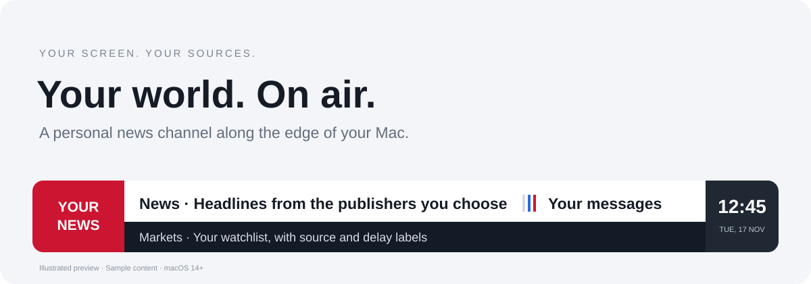

# Stroka

### Твой Mac. Твой эфир.

**Твои источники. Твоё имя. Твой новостной канал.**

[Попробовать на Mac](https://github.com/kosbushe/stroka/releases/tag/v0.23.1-beta.1) · [English](README.md) · [План развития](ROADMAP.md)



Для эпохи сотни открытых вкладок. Stroka превращает край экрана в личный эфир: любимые издания, публичные Telegram-каналы, котировки и свои сообщения.

Напиши своё название. Выбери оформление. Задай темп. Пока ты занимаешься своим делом, рядом движется то, что выбрал ты.

| Что читать | Как выглядит | Как движется |
|---|---|---|
| RSS, публичный Telegram, котировки и свои слова | Твоё имя или логотип, четыре оформления и часы | До четырёх строк, сверху или снизу, в твоём темпе |

**Нативно для Mac · Apple Silicon и Intel · Локальные настройки · Без регистрации**

## Что будет в твоём эфире?

- **Утренний радар.** Технологии, AI, бизнес, наука, кино, спорт. Выбирай издания, которые хочется читать именно тебе.
- **Взгляд на рынки.** Нужные инструменты перед глазами, с указанием источника и частоты обновления.
- **Твоя следующая сессия.** Приветствие, вопрос для обсуждения или своё объявление на экране Mac.

Слева твоё название или логотип. Справа время, дата и день недели. Между ними выбранная информация. Высота **45-180 пунктов**; нижние строки по умолчанию чуть быстрее верхних.

## Выбрал. Оформил. Запустил.

1. Отметь источники или добавь HTTPS RSS/Atom. Для публичного Telegram-канала достаточно **@названия**.
2. Напиши своё имя эфира и выбери **Новости**, **Ночной**, **Минимал** или **Glass**.
3. Нажми **Запустить строку**. Двойной щелчок вернёт настройки, один щелчок или пробел поставит эфир на паузу.

Сохрани свой вариант в **Настройки → Сохранённые настройки**, чтобы вернуться к нему позже.

## Маленькая полоса. Большой выбор.

**550 адресов лент · 11 тем · 96 авторских двуязычных офлайн-сообщений · 4 оформления · До 4 строк**

В каталоге есть русские и английские ленты. Это адреса источников, а не 550 разных изданий. Доступность меняется; последняя полная зафиксированная проверка была 14 ноября 2026.

Новости живут в эфире менее 24 часов. Особые публикации, явно отмеченные человеком, - менее 48. Загрузка, редактирование и перевод не делают старую новость новой. Котировки поступают от Coinbase, MOEX и из справочных курсов CBR/ECB: у каждого поставщика указаны источник и частота/задержка. Не все данные обновляются в реальном времени.

## Где попробовать

| Платформа | Статус |
|---|---|
| **Mac** | Бета **0.23.1 (30)** для macOS 14+, Apple Silicon/Intel. Перевод на русский использует Apple Translation и требует macOS 15+ с подготовленными языковыми моделями. |
| **Android TV / Google TV** | Экспериментальный приёмник **0.2.2**, Mac должен оставаться включённым. Базовый показ проверен на Philips Android TV 11 в версии 0.2.1; у 0.2.2 нет отдельной длительной приёмки. [Инструкция](TVCompanion/README.md). |
| **iPhone + самостоятельный ТВ** | [Отдельный Lab](Labs/Ecosystem/README.md): общий редактор, QR/TLS и движок на ТВ. Сборка/установка iOS и полное совпадение функций ещё впереди. |
| **Windows** | Направление будущего порта. Готовой версии пока нет. |

## Скачать и собрать

[Первый GitHub prerelease](https://github.com/kosbushe/stroka/releases/tag/v0.23.1-beta.1) содержит Mac-сборку, ТВ-приёмник и контрольные суммы. Это локально подписанные прототипы, без Developer ID notarization и публикации в магазинах. Системные защиты macOS должны оставаться включёнными; если система не принимает сборку, используйте сборку из исходников.

```sh
git clone https://github.com/kosbushe/stroka.git
cd stroka
zsh build.sh "$PWD/dist"
open "$PWD/dist/Stroka.app"
```

Нужны инструменты разработчика Apple, совместимые Swift/macOS SDK. Перевод требует macOS 15+, само приложение - macOS 14+. Инструкция для ТВ - [здесь](TVCompanion/README.md); для будущей установки на iPhone - [здесь](Labs/Ecosystem/Docs/INSTALL-iPhone.md). Отдельные языковые модели могут потребовать системной загрузки.

## Границы бета-версии

Настройки, тексты и кэш хранятся локально. Нет сервера разработчика, аналитики и рекламного SDK. Издатели получают обычные сетевые сведения при запросе выбранных источников. Текущее зеркалирование ТВ использует локальный HTTP и предназначено для доверенной домашней сети. Зашифрованное QR-соединение нового Lab - отдельный протокол.

Нет автоматического изменения чужих окон, Windows-сборки, таймеров, универсального чтения личных лент X/Threads и гарантии работы поверх всех ТВ-приложений/HDMI/DRM. Проверки, ограничения и история приёмки опубликованы в [финальном обзоре](Docs/FINAL-REVIEW.md).

## Права и обратная связь

Исходники опубликованы для просмотра. **Лицензия открытого исходного кода пока не выбрана**, авторские права сохранены: [LICENSE](LICENSE). Условия переиспользования и участия нужно согласовать отдельно. Ленты, статьи, логотипы и рыночные данные сохраняют права своих поставщиков. ZXing в Lab имеет собственную лицензию Apache 2.0.

Обычные вопросы и предложения - [Issues](https://github.com/kosbushe/stroka/issues). Уязвимости - через [приватное сообщение GitHub](https://github.com/kosbushe/stroka/security/advisories/new), без ключей и личных данных в публичном обсуждении. [Приватность](Privacy.txt) · [Безопасность](SECURITY.md) · [Задача проекта](Docs/PROJECT-BRIEF.md).
